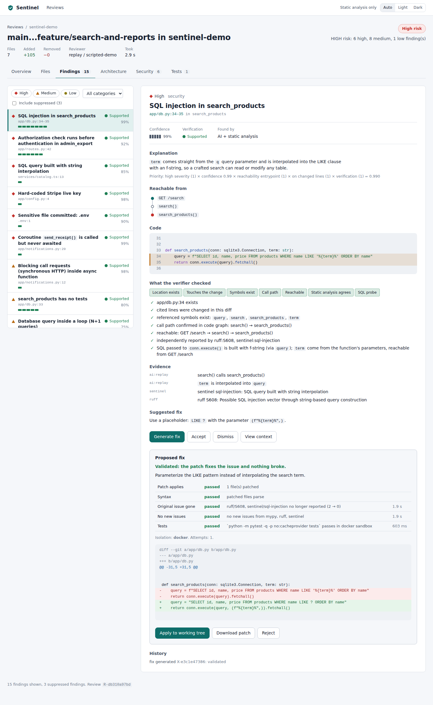
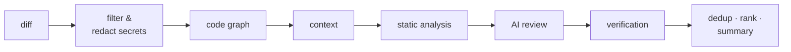

# Sentinel

**Context-aware AI code review that checks its own claims.**

Sentinel reviews a code change — staged files, a commit range, or a GitHub pull request —
in the context of the whole codebase. An AI model proposes problems; deterministic
analysis then **checks each claim against the available evidence** before you see it. Findings come
with the evidence, the call path from the nearest entry point, and the exact checks that
confirmed or rejected them. For confirmed problems Sentinel can generate a fix, test it in a
locked-down sandbox, and apply it when you say so.

**Release status:** V1 is complete against the SPEC's definition of done within its
documented supported limits; see the [requirement comparison and remaining work](docs/SPEC_COMPLETION.md).
This is not a guarantee of complete bug detection or exploit proof. Changes that remove code compare diagnostics across the eligible
base and head source trees, including unchanged dependents. Missing snapshots, tools or analysis
coverage make that review partial. Static patterns and inferred call paths remain limited.
Fix validation requires a Docker image
containing project dependencies. POSIX filesystem confinement requires Linux/WSL for local fixes.
See [release readiness](docs/RELEASE_READINESS.md) for current evidence, and the dated
[audit remediation](docs/REMAINING_AUDIT_REMEDIATION.md) for the earlier defect history.

Learning on Windows? Start with [local setup, free AI and GitHub explained step by step](docs/LOCAL_SETUP_AND_GITHUB.md).
For how the code works, follow [WALKTHROUGH.md](docs/WALKTHROUGH.md) and
[the code-graph explanation](docs/GRAPH_ANALYSIS.md).



## Why it exists

AI reviewers are fast but unreliable: they invent functions, flag parameterized queries as
SQL injection, and file style nits as bugs. After a few false alarms developers stop
reading. Static analysers are reliable but shallow: they do not know that `term` comes
straight from `GET /search`.

Sentinel combines the two the other way round from most tools: **the model proposes,
deterministic systems verify.** A claim survives only if the code supports it — a probe
proves the query really is built from a string, the code graph confirms `search()` really
calls `search_products()`, an independent tool reports the same issue. Claims the code
contradicts are rejected *and shown as rejected*, with the reason.

## Architecture



- **Eight-stage pipeline** with live progress; a failing stage degrades the review to
  `PARTIAL` instead of hiding what worked.
- **Code graph** of symbols, calls, imports, routes, tests and data access (Python via
  `ast`, TypeScript/JavaScript via the TypeScript compiler) drives context selection and
  verification.
- **Ports and adapters**: the review engine depends on interfaces (`AIProvider`,
  `StaticAnalyzer`, `Sandbox` …); vendors, databases and frameworks plug in from the outside.
- **Delivery**: a CLI, a FastAPI server with a React UI, background workers on a
  database-backed job queue, and a GitHub App.

Details and diagrams: **[docs/ARCHITECTURE.md](docs/ARCHITECTURE.md)** ·
reasons: **[docs/DESIGN_DECISIONS.md](docs/DESIGN_DECISIONS.md)**.

## Demo — no AI key required

Try the [public sample and beginner walkthrough](docs/PUBLIC_DEMO.md). Everything
is included in this repository; no GitHub account, AI subscription or model download
is required. Use Linux or Ubuntu in WSL 2 with Python 3.11+, Node 22.13+ and Docker.

```bash
git clone https://github.com/krish-121/Ai-code-reviewer.git sentinel
cd sentinel
python3 -m venv .venv
source .venv/bin/activate
python -m pip install -c requirements.lock -e ".[dev,analyzers]"
npm ci --prefix tools/analyzers --omit=dev --no-audit --no-fund
export PATH="$PWD/tools/analyzers/node_modules/.bin:$PATH"
export NODE_PATH="$PWD/tools/analyzers/node_modules"
docker build -f Dockerfile.sandbox -t sentinel-sandbox:latest .
python scripts/seed_demo.py
python scripts/serve_demo.py
```

Open **http://127.0.0.1:8820**. The sample has two Git branches with planted SQL,
authorization, async, error-handling, performance and test-coverage problems. The
review shows supported/likely findings and three rejected claims. Its prepared SQL
proposal restores parameter binding and adds four test cases. All seven normal
checks run; **Apply remains an explicit browser action** on the disposable sample.

**AI replies are scripted**, labelled `replay / scripted-demo`. Analysis, code graph,
verification, Docker tests, persistence and Apply are real. This is a repeatable
workflow demonstration, not evidence of model accuracy. The script uses isolated
demo settings and never loads your saved API keys. Setup downloads packages/images;
the demonstration makes no AI service calls.

The intentionally committed `.env` and Stripe-shaped string are invented scanner
fixtures. Never replace them with live credentials. Local `.demo/`, keys, dependencies
and databases stay ignored. Rerunning the seed refuses existing paths; reopen with
`serve_demo.py` or follow the guide's fresh-path example. No GitHub App is required.


The [guide](docs/PUBLIC_DEMO.md) explains each command, how to inspect rejected
findings, Apply, restart, and optionally use your own live AI provider. Start with
`--review-only` if Docker is unavailable; that does not claim fix-validation success.

The [fresh public-download confirmation](docs/PUBLIC_DEMO_VERIFICATION.md) records a new environment, browser regeneration, seven real Docker checks, explicit Apply and six final sample tests. All three implementation checks passed in GitHub.

### Actual browser acceptance

The [19 October live browser walkthrough](docs/BROWSER_LIVE_WORKFLOW.md) records real
Gemini 3.5 Flash-Lite and free DeepSeek reviews, fix generation, seven Docker checks
and explicit Apply on disposable examples. DeepSeek's quota trigger was controlled
locally; its answer was real. The saved Gemini 3.8 default was busy and remains unchanged.
These screenshots show actual applied fixes; the earlier demo screenshots remain labelled replay.


## Installation

Runs on Linux and macOS. **On Windows, use WSL 2** (Ubuntu): the sandbox code uses
POSIX-only calls. You need:

- Python 3.11+ and git
- Node.js 22.13+ with the `typescript` package — full TypeScript structure (otherwise a
  labelled regex fallback is used), and needed to change the web UI
- Docker — to validate fixes by running their tests in the sandbox
- PostgreSQL 16 — optional; SQLite is the default

```bash
git clone https://github.com/krish-121/Ai-code-reviewer.git sentinel && cd sentinel     # or unzip the project archive
python3 -m venv .venv && source .venv/bin/activate
pip install -U pip && pip install -c requirements.lock -e ".[dev,analyzers]" # + ",postgres" for PostgreSQL
npm ci --prefix tools/analyzers --omit=dev --no-audit --no-fund
export PATH="$PWD/tools/analyzers/node_modules/.bin:$PATH"
export NODE_PATH="$PWD/tools/analyzers/node_modules"
docker build -f Dockerfile.sandbox -t sentinel-sandbox .   # for fix validation
cd web && npm ci && cd ..   # only to change the UI; the built UI is already included
```

Check the setup with `pytest` (see [Testing](#testing)) and `python scripts/seed_demo.py`.
Before changing code, read [CONTRIBUTING.md](CONTRIBUTING.md).

Team server with PostgreSQL, API, UI, review worker and Docker validation worker:
`docker compose up --build` — see
[docs/DEPLOYMENT.md](docs/DEPLOYMENT.md).

## CLI usage

Choose one review source per command: a path, `--staged`, `--worktree`, `--range`
or `--pr`. Conflicting sources are rejected. `--repo` is used only with `--pr`.
Paths must exist; an existing empty folder is valid. With no explicit source,
Sentinel chooses staged changes if present, otherwise uncommitted changes.

```bash
sentinel review --staged                 # what you are about to commit
sentinel review --worktree               # everything uncommitted
sentinel review --range main..my-branch  # a branch
sentinel review src/payments/            # every file under a folder
sentinel review --pr 42 --repo acme/shop # a GitHub PR (needs SENTINEL_GITHUB_TOKEN; posts nothing)

sentinel review --staged --details --show-suppressed   # evidence, checks, rejected claims
sentinel review --staged --format json                 # machine-readable
sentinel review --staged --fail-on high                # exit 1 on high findings (CI)

sentinel findings                 # findings of the latest review
sentinel show F-3fa9c2d1e0        # one finding, all evidence and checks
sentinel fix F-3fa9c2d1e0 --apply # generate, validate in the sandbox, apply after confirmation
sentinel accept F-…  /  sentinel dismiss F-… --note "intended"
sentinel reviews                  # history

sentinel config                   # effective settings (secrets masked)
sentinel config set provider claude
sentinel config init              # write a .sentinel.yml template
sentinel serve                    # web UI at http://127.0.0.1:8000
```

Exit codes: `0` success · `1` `--fail-on` threshold reached · `2` configuration or usage
error · `3` the review or fix failed.

Per-repository rules live in `.sentinel.yml` (categories, display budget, confidence and
severity thresholds, ignored paths, disabled analyzers, the test command for fixes).

## GitHub integration

Install Sentinel as a GitHub App with three permissions (contents: read, pull requests:
write, issues: write). Each push to a pull request queues a review; a worker posts **one
summary comment that is edited in place** and inline comments for new findings only, so
repeat publication deduplicates owned comment markers. Superseded revisions are rejected;
GitHub's final compare-and-comment race remains documented in `docs/GITHUB_APP.md`.
Sentinel comments; it never approves or blocks.
Setup: **[docs/GITHUB_APP.md](docs/GITHUB_APP.md)**.

## AI providers

Bring your own key — or none:

| Provider | Setting | Key |
|---|---|---|
| Anthropic Claude | `SENTINEL_PROVIDER=claude` | `SENTINEL_CLAUDE_KEY` or `ANTHROPIC_API_KEY` |
| Google Gemini | `SENTINEL_PROVIDER=gemini` | `SENTINEL_GEMINI_KEY` or `GEMINI_API_KEY` |
| Ollama (local) | `SENTINEL_PROVIDER=ollama` | none; `SENTINEL_OLLAMA_URL` |
| Free DeepSeek through OpenCode | `SENTINEL_PROVIDER=opencode` | separate local bridge token; no vendor key |
| None | `SENTINEL_PROVIDER=none` or `--no-ai` | deterministic review only |

Providers use `httpx` over vendor HTTPS or local bridge HTTP (no vendor SDKs) and must answer
with JSON that validates against a strict schema; invalid answers get one correction
retry, rate limits are retried with backoff, timeouts once. Choose a model with
`SENTINEL_MODEL` or `--model`. Adding a provider is one class and one registry entry
([how](docs/WALKTHROUGH.md#add-an-ai-provider)).

For **Gemini -> free DeepSeek when quota is exhausted**, start the isolated bridge
with `python scripts/opencode_bridge.py start --build`, select Gemini and enable
`sentinel config set free_fallback true`. The helper creates a private local token;
Google's key stays outside Docker. Use a Gemini Free Tier project without billing.
Only explicit quota/rate-limit errors switch models; actual winner and reason are
recorded, and local findings remain available if AI fails. GLM is excluded after
service failures. See [setup, source tour and verified limits](docs/FREE_AI_FALLBACK.md).

## Testing

```bash
pytest                                            # unit, integration, golden and end-to-end tests
pytest --cov=sentinel                              # ≈94% overall, ≈97% of core/
SENTINEL_TEST_DATABASE_URL=postgresql://… pytest -m postgres   # store/queue/API/e2e on PostgreSQL
ruff check src tests scripts && mypy               # lint (incl. complexity & docstrings), strict types
cd web && npm run lint && npm test && npm run build
```

- No test calls a live AI provider or GitHub. HTTP mocks cover malformed JSON, missing
  fields, rate limits, timeouts and provider errors. Compose acceptance uses a local
  deterministic HTTP provider fixture with the real API, PostgreSQL and workers.
- **Golden tests** ([`tests/golden/cases/`](tests/golden/cases/)) pin the outcome for SQL
  injection, an auth bypass, a race condition, performance problems, secrets, prompt
  injection, TypeScript and a clean change — including which wrong AI claims must be
  rejected.
- The **end-to-end test** drives a pull request from webhook to published comments through
  the real API, worker, pipeline and database.
- CI ([`.github/workflows/ci.yml`](.github/workflows/ci.yml)) runs all of the above plus the
  Docker sandbox tests and complete isolated Compose acceptance (including validated
  multi-file Apply and persistence after service recreation). Performance numbers:
  [docs/BENCHMARKS.md](docs/BENCHMARKS.md).

## Security model

Sentinel handles source code, which may contain secrets and hostile content.

- **Secret filtering and redaction.** Recognized `.env` files, private keys and credential stores are
  excluded; detected secrets elsewhere are redacted in the diff, in the context and in the final
  prompt. Unrecognized credentials can escape pattern detection; review the material you share.
- **Repository content is data, not instructions.** It is fenced in tags with a per-review
  nonce that the content cannot forge; text aimed at an AI reviewer is reported as a
  finding. Claims are checked against available evidence, with uncertainty reported explicitly.
- **Untrusted pull requests cannot execute code on the server**: no project-local linters,
  type-checker plugins or packages are loaded for PR reviews.
- **Generated code never runs on the host.** Fix tests run in containers with no network, a
  read-only filesystem, resource limits and no capabilities; fixes are applied only on
  request and only if the files have not changed.
- **Tenancy**: every lookup is scoped to the user who owns the repository; API tokens are
  stored hashed. Local mode binds to loopback and guards against DNS rebinding and CSRF.
- **Least privilege** for GitHub; webhook signatures are verified.

Full table: [ARCHITECTURE.md §10](docs/ARCHITECTURE.md#10-security-boundaries).

## Documentation

| | |
|---|---|
| [ARCHITECTURE.md](docs/ARCHITECTURE.md) | System, pipeline, code graph, verification, fixes, GitHub flow (Mermaid) |
| [DESIGN_DECISIONS.md](docs/DESIGN_DECISIONS.md) | Problem → alternatives → decision → trade-offs |
| [WALKTHROUGH.md](docs/WALKTHROUGH.md) | One review traced through the code, and *how to change common things* |
| [STUDY_GUIDE.md](docs/STUDY_GUIDE.md) | A 14-day reading plan |
| [GITHUB_APP.md](docs/GITHUB_APP.md) · [DEPLOYMENT.md](docs/DEPLOYMENT.md) | Running it for a team |
| [GITHUB_LIVE_TEST.md](docs/GITHUB_LIVE_TEST.md) | Real GitHub App setup, PR review, retries and correction explained step by step |
| [QUALITY_EVALUATION.md](docs/QUALITY_EVALUATION.md) · [Example corpus](evals/review_quality/README.md) | Real Python/JS/TS review and fix checks, reproducible samples and limits |
| Pricing contract repair | [Why the old fix failed, the repair and live retest](docs/PRICING_FIX_INVESTIGATION.md) |
| Cross-file live evaluation | [Multi-file examples, results and repairs](docs/MULTIFILE_QUALITY_EVALUATION.md) |
| [BENCHMARKS.md](docs/BENCHMARKS.md) | Measured latency and memory by repository size |
| [RELEASE_READINESS.md](docs/RELEASE_READINESS.md) | Current checks, remaining gaps and rough work estimate |
| [DATABASE_MIGRATIONS.md](docs/DATABASE_MIGRATIONS.md) · [MULTI_FILE_FIXES.md](docs/MULTI_FILE_FIXES.md) | Upgrades, legacy adoption and coordinated fixes |
| [PROGRESS.md](PROGRESS.md) | Build status, assumptions, what is verified only with mocks, open questions |
| [CONTRIBUTING.md](CONTRIBUTING.md) · [SPEC.md](docs/SPEC.md) | Code-quality standard and pre-commit checks · the original product spec |

## Project status

The core V1 workflows are implemented; release acceptance and the remaining limitations
are tracked in [PROGRESS.md](PROGRESS.md). Things to know:

- Gemini, the free DeepSeek bridge and the GitHub App have local live acceptance
  evidence alongside offline tests. Broader model accuracy and production hosting
  remain open; see the current status and evaluation reports.
- The web UI is a React + TypeScript single-page app bundled with esbuild rather than the
  recommended Next.js/Tailwind/shadcn/Monaco stack (the build environment had no npm
  registry access).
- Database upgrades use [versioned migrations](docs/DATABASE_MIGRATIONS.md). Existing
  unversioned databases require explicit, validated adoption before startup.
- [Multi-file fixes](docs/MULTI_FILE_FIXES.md) can coordinate supplied files and create
  an approved regression test, with Docker validation and guarded application.

License: MIT.
