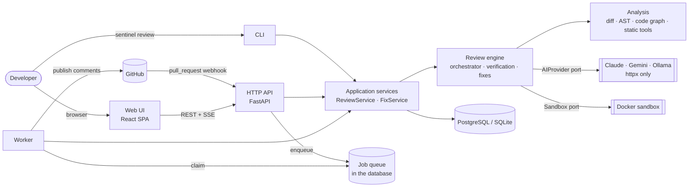
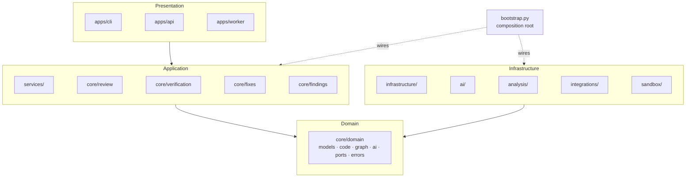
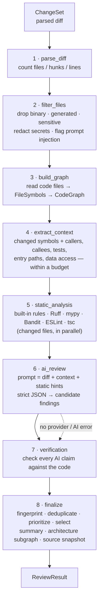
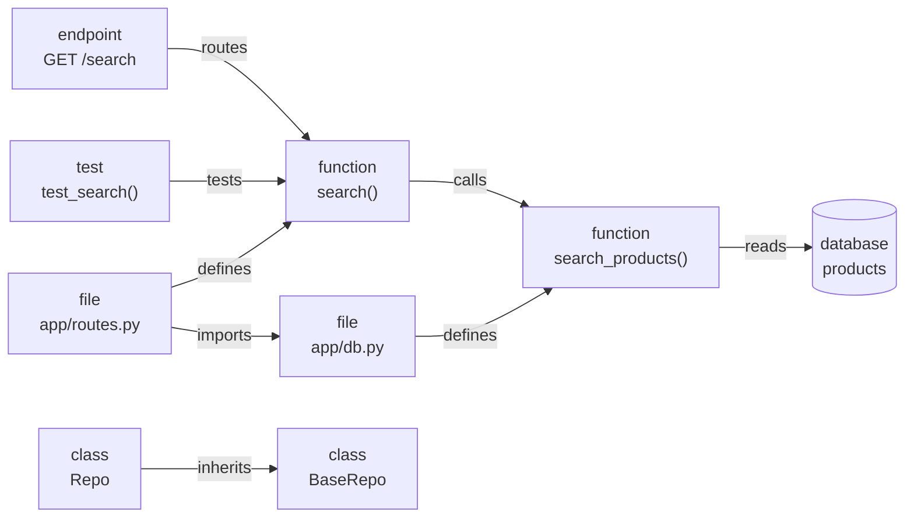
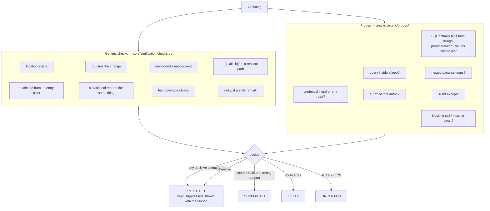
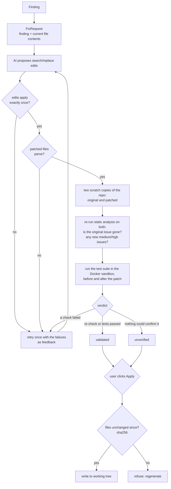
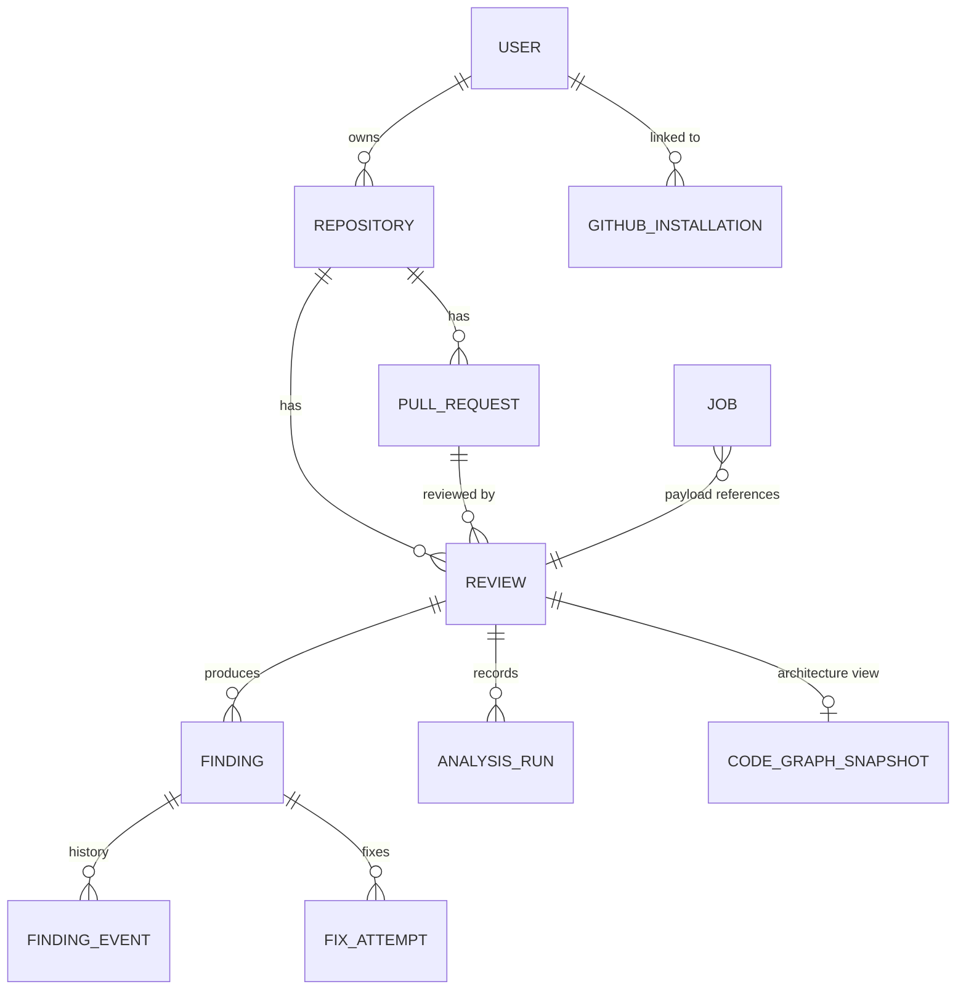
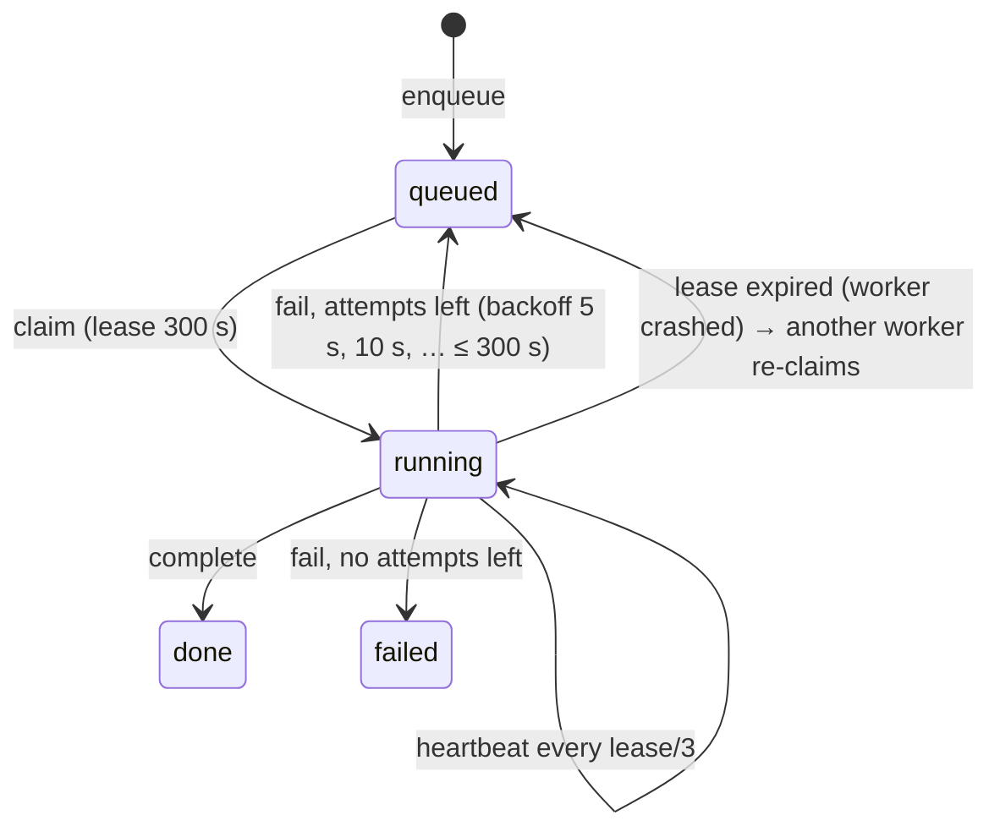

# Architecture

Sentinel reviews a code change the way a careful senior engineer would: it reads the
diff *in the context of the codebase*, lets an AI model propose problems, and then
**checks every claim against the code before showing it to you**. This document shows how
the pieces fit. For the reasons behind each choice see
[DESIGN_DECISIONS.md](DESIGN_DECISIONS.md); to follow one review through the code line by
line see [WALKTHROUGH.md](WALKTHROUGH.md).

Contents: [system](#1-system-architecture) · [layers](#2-layers-and-dependency-direction) ·
[review pipeline](#3-review-pipeline) · [code graph](#4-code-graph) ·
[finding verification](#5-finding-verification) · [fix validation](#6-fix-validation) ·
[GitHub workflow](#7-github-workflow) · [data model](#8-data-model) ·
[jobs and progress](#9-background-jobs-and-live-progress) · [security](#10-security-boundaries)

## 1. System architecture



| Part | Where | What it does |
|---|---|---|
| CLI | [`apps/cli/`](../src/sentinel/apps/cli/) | `sentinel review`, `fix`, `findings`, `config`, `serve`, `worker` … |
| HTTP API | [`apps/api/`](../src/sentinel/apps/api/) | JSON API for the UI, GitHub webhook receiver, SSE progress stream, serves the UI |
| Worker | [`apps/worker/main.py`](../src/sentinel/apps/worker/main.py) | Runs queued `review`, `publish` and `fix` jobs |
| Services | [`services/`](../src/sentinel/services/) | The use cases shared by CLI, API and worker; own transactions |
| Review engine | [`core/`](../src/sentinel/core/) | Pipeline, verification, findings, fixes, summary — no I/O frameworks |
| Analysis | [`analysis/`](../src/sentinel/analysis/) | Diff parsing, filtering, language analyzers, code graph, static tools, probes |
| AI | [`ai/`](../src/sentinel/ai/) | Prompts, JSON schemas, provider adapters over `httpx` |
| Infrastructure | [`infrastructure/`](../src/sentinel/infrastructure/) | Database, job queue, cache, logging, metrics |
| Integrations | [`integrations/github/`](../src/sentinel/integrations/github/) | GitHub App auth, REST client, webhook parsing, comment publishing |
| Sandbox | [`sandbox/runners.py`](../src/sentinel/sandbox/runners.py) | Runs tests of proposed fixes in locked-down containers |
| Web UI | [`web/`](../web/) | React + TypeScript single-page app, bundled into the Python package |

## 2. Layers and dependency direction

The spec's rule (§34) — *the domain knows nothing about FastAPI, GitHub, PostgreSQL,
Gemini, Claude or React* — is enforced by a test,
[`test_core_does_not_depend_on_delivery_or_vendors`](../tests/unit/test_infrastructure.py).



- **Ports** ([`core/domain/ports.py`](../src/sentinel/core/domain/ports.py)) are the
  interfaces the engine depends on: `AIProvider`, `StaticAnalyzer`, `LanguageAnalyzer`,
  `Cache`, `ProgressReporter`, `SandboxRunner`. The orchestrator never imports a concrete
  provider: `FindingService → GeminiClient` is impossible by construction.
- **[`bootstrap.py`](../src/sentinel/bootstrap.py)** is the only module that knows which
  concrete analyzers, probes, providers, caches and sandboxes exist
  (`build_orchestrator`, `build_fix_engine`, `build_sandbox`, `github_factory`).
- **Errors**: every expected failure derives from
  [`SentinelError`](../src/sentinel/core/domain/errors.py); the CLI prints it, the API maps
  it to an HTTP status, the pipeline marks the stage failed.

## 3. Review pipeline

[`ReviewOrchestrator.review`](../src/sentinel/core/review/orchestrator.py) runs eight
stages. Each stage is one method; they share a
[`PipelineState`](../src/sentinel/core/review/state.py). Every stage is timed, reported to
the progress listener (terminal spinner, database → browser) and logged as one structured
line. **A failing stage degrades the review to `PARTIAL`; it never hides the stages that
did work.**



| Stage | Main code |
|---|---|
| parse | [`parse_unified_diff`](../src/sentinel/analysis/diff/parser.py), [`git.py`](../src/sentinel/analysis/diff/git.py) |
| filter | [`filter_changeset`](../src/sentinel/analysis/diff/filtering.py), [`secrets.py`](../src/sentinel/analysis/diff/secrets.py), [`scan_for_injection`](../src/sentinel/analysis/diff/injection.py) |
| graph | [`collect_sources`](../src/sentinel/core/review/workspace.py), [`LanguageRegistry`](../src/sentinel/analysis/ast/registry.py), [`build_graph`](../src/sentinel/analysis/graph/builder.py) |
| context | [`ContextEngine.build`](../src/sentinel/analysis/graph/context.py) |
| static | [`StaticAnalysisRunner`](../src/sentinel/analysis/static/runner.py) and the adapters next to it |
| AI | [`build_review_request`](../src/sentinel/core/review/ai_request.py), [`build_review_prompt`](../src/sentinel/ai/prompts/__init__.py), [`HTTPProvider.review`](../src/sentinel/ai/providers/base.py), [`normalize_ai_findings`](../src/sentinel/core/findings/normalize.py) |
| verify | [`VerificationEngine`](../src/sentinel/core/verification/engine.py), [`checks.py`](../src/sentinel/core/verification/checks.py), [`probes/`](../src/sentinel/analysis/static/probes/) |
| finalize | [`deduplicate`](../src/sentinel/core/findings/dedup.py), [`select`](../src/sentinel/core/findings/prioritize.py), [`build_summary`](../src/sentinel/core/review/summary.py), [`architecture_subgraph`](../src/sentinel/analysis/graph/architecture.py) |

Deterministic findings (from the filter stage and static tools) are verified *by
construction*; only AI claims go through the checks. Static findings outside the changed
lines are kept but suppressed as "pre-existing".

## 4. Code graph

Every language analyzer turns a file into the same language-neutral shape,
[`FileSymbols`](../src/sentinel/core/domain/code.py) (symbols, imports, call sites,
endpoints, database operations). The [graph builder](../src/sentinel/analysis/graph/builder.py)
turns all of them into one [`CodeGraph`](../src/sentinel/core/domain/graph.py):



Node kinds: file, module, class, function, method, variable, test, endpoint, database.
Edge kinds: imports, calls, defines, inherits, implements, tests, reads, writes, routes.

Name resolution ([`resolution.py`](../src/sentinel/analysis/graph/resolution.py)) is
deliberately conservative — a call edge is drawn only when the target is certain enough:
same-file definitions, explicit imports (including relative Python imports and `./x` /
`@/x` TypeScript specifiers), `self.`/`this.` methods with inheritance, and names that are
unique in the repository. A missing edge costs some context; a wrong edge would mislead
the verifier.

The graph answers the questions the rest of the system asks:
`callers`, `callees`, `path_from_entrypoint` (reverse BFS to the nearest endpoint, CLI
command, `main` or exported symbol), `tests_for`, `call_path`, `enclosing`.

Languages: Python via the standard-library `ast`
([`python_analyzer.py`](../src/sentinel/analysis/ast/python_analyzer.py)); TypeScript and
JavaScript via the real TypeScript compiler API run once per review in Node
([`ts_extract.js`](../src/sentinel/analysis/ast/ts_extract.js)), with a clearly-labelled
regex fallback ([`typescript_fallback.py`](../src/sentinel/analysis/ast/typescript_fallback.py))
when Node or `typescript` is missing.

## 5. Finding verification

*AI proposes, deterministic systems verify.* Each AI claim runs through independent
checks; each check returns *supports*, *contradicts*, *neutral* or nothing, with a weight
and a human-readable detail that the UI shows verbatim.



- The score is the weighted share of supporting minus contradicting checks, in [-1, 1].
  "Strong support" means a supporting check with weight ≥ 1.5 — a probe or an independent
  static tool, never the model's own say-so. Thresholds are named constants at the top of
  [`engine.py`](../src/sentinel/core/verification/engine.py).
- [`apply_verification`](../src/sentinel/core/verification/engine.py) blends the model's
  confidence with the evidence: supported claims get at least 0.8, rejected ones at most
  0.2, nothing gets 1.0.
- Rejected claims are never merged with a real finding during deduplication (a refuted
  claim must not borrow credibility), and are listed in the summary as "Rejected N
  unsupported claim(s)".

## 6. Fix validation



The repository itself is never modified until the user explicitly applies a fix
([`apply_fix`](../src/sentinel/core/fixes/engine.py)). Generated code runs only inside the
sandbox: no network, read-only root filesystem, capped memory/CPU/PIDs, all capabilities
dropped, a throwaway copy mounted as the working directory, a hard timeout
([`DockerSandbox.command`](../src/sentinel/sandbox/runners.py)). Tests that already fail
before the patch are not blamed on it. Code:
[`engine.py`](../src/sentinel/core/fixes/engine.py),
[`validation.py`](../src/sentinel/core/fixes/validation.py),
[`patch.py`](../src/sentinel/core/fixes/patch.py),
[`scratch.py`](../src/sentinel/core/fixes/scratch.py).

## 7. GitHub workflow

```mermaid
sequenceDiagram
    autonumber
    participant GH as GitHub
    participant API as Sentinel API
    participant DB as Database (jobs + reviews)
    participant W as Worker
    participant AI as AI provider
    GH->>API: POST /api/github/webhook (pull_request opened / synchronize)
    API->>API: verify HMAC signature, parse event
    API->>DB: create Review (queued) + review job
    API-->>GH: 202 Accepted (fast; no review inside the request)
    W->>DB: claim job (lease + heartbeats)
    W->>GH: installation token (contents:read, pull_requests:write, issues:write)
    W->>GH: PR metadata, unified diff, tarball of the head commit
    W->>W: review pipeline (repository treated as untrusted)
    W->>AI: prompt (redacted, fenced as data)
    AI-->>W: JSON findings
    W->>DB: save result, stages, findings; enqueue publish job
    W->>DB: claim publish job
    W->>GH: list existing comments (fingerprint markers)
    W->>GH: create or update the summary comment
    W->>GH: one review with inline comments for new findings only
```

- **Idempotent publishing**
  ([`GitHubPublisher`](../src/sentinel/integrations/github/publisher.py)): the summary
  comment carries `<!-- sentinel:summary -->` and is edited on every push; inline comments
  carry `<!-- sentinel:fp=… -->` so a finding already on the PR is not posted again.
- **GitHub unavailable**: publishing is a separate job with retries (exponential backoff,
  6 attempts). The review result is already saved, so nothing is lost.
- **Least privilege**: installation tokens are requested with
  [`MIN_PERMISSIONS`](../src/sentinel/integrations/github/client.py) only. Setup:
  [GITHUB_APP.md](GITHUB_APP.md).

## 8. Data model



Schema: [`infrastructure/database/models.py`](../src/sentinel/infrastructure/database/models.py).
All reads and writes go through [`Store`](../src/sentinel/infrastructure/database/store.py),
whose lookups take the current user: **the repository owner is the tenancy boundary**, and
a review another user owns is indistinguishable from one that does not exist (HTTP 404).
A finding row stores the full domain `Finding` as JSON (`data`) plus the columns that change
afterwards (status, suppression) and the fingerprint (indexed).

## 9. Background jobs and live progress



- The queue is a table ([`jobs.py`](../src/sentinel/infrastructure/queue/jobs.py)): a worker
  claims a job with a conditional `UPDATE` (plus `SELECT … FOR UPDATE SKIP LOCKED` on
  PostgreSQL), so several workers never run the same job — tested with racing threads on
  both SQLite and PostgreSQL.
- Live progress: each stage transition is written to the review row
  ([`DBProgress`](../src/sentinel/services/reviews.py)); the browser follows
  `GET /api/reviews/{id}/events`, a Server-Sent Events stream that polls that row
  ([`progress_events`](../src/sentinel/apps/api/routes/reviews.py)). Because it reads the
  database, it works no matter which worker process runs the review.

## 10. Security boundaries

| Threat | Defence | Where |
|---|---|---|
| Secrets sent to a model | `.env`, private keys, credential stores never read; secrets on other lines redacted (diff, context, prompt — three layers) | [`filtering.py`](../src/sentinel/analysis/diff/filtering.py), [`secrets.py`](../src/sentinel/analysis/diff/secrets.py), [`context.py`](../src/sentinel/analysis/graph/context.py), [`prompts`](../src/sentinel/ai/prompts/__init__.py) |
| Prompt injection in code | Repository text fenced in `<untrusted_* nonce=…>` tags, tag look-alikes neutralised, model told it is data; injection text reported as a finding; verification never trusts the model's word | [`prompts`](../src/sentinel/ai/prompts/__init__.py), [`injection.py`](../src/sentinel/analysis/diff/injection.py) |
| Malicious PR executing code | PR workspaces are untrusted: no project-local tool binaries, mypy plugins/config or workspace TypeScript are loaded | `trust_workspace` in [`runner.py`](../src/sentinel/analysis/static/runner.py), [`bootstrap.py`](../src/sentinel/bootstrap.py) |
| Generated code on the host | Tests run only in the sandbox; the process sandbox is opt-in and labelled | [`runners.py`](../src/sentinel/sandbox/runners.py) |
| Path traversal | Diff paths and tarball members outside the repository are rejected | [`safe_path`](../src/sentinel/analysis/diff/parser.py), [`client.py`](../src/sentinel/integrations/github/client.py) |
| Cross-tenant access | Every lookup scoped by user; tested in token mode | [`Store`](../src/sentinel/infrastructure/database/store.py), [`test_token_mode_isolates_tenants`](../tests/integration/test_api.py) |
| Browser attacks on local mode | Loopback only, `Host` allow-list (DNS rebinding), `X-Sentinel-Client` header on writes (CSRF) | [`app.py`](../src/sentinel/apps/api/app.py), [`dependencies.py`](../src/sentinel/apps/api/dependencies.py) |
| Forged webhooks | HMAC-SHA256 signature with a constant-time comparison | [`webhooks.py`](../src/sentinel/integrations/github/webhooks.py) |
| Over-privileged GitHub token | Installation tokens scoped to three permissions | [`client.py`](../src/sentinel/integrations/github/client.py) |
| Keys leaking into tools | Child processes get a scrubbed environment | [`scrubbed_env`](../src/sentinel/analysis/static/base.py), [`ProcessSandbox`](../src/sentinel/sandbox/runners.py) |
