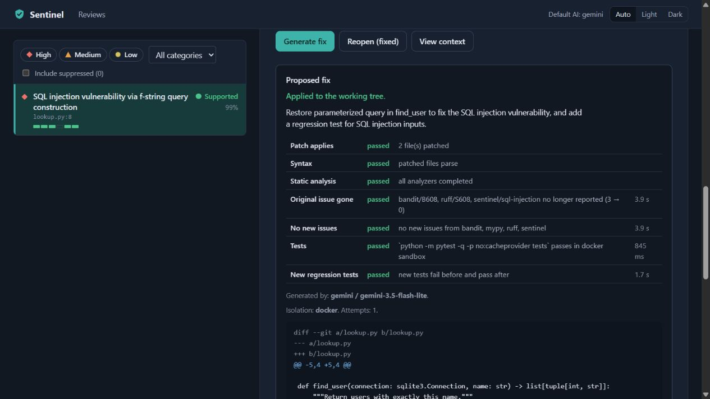
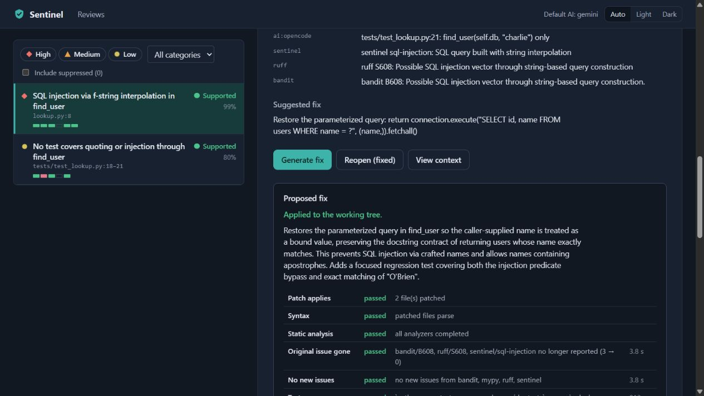

# Real browser review, validation and Apply

Verified **19 October 2026**, using the main Sentinel checkout and its actual served
web UI at `http://127.0.0.1:8810`. Both a real Gemini model and real free DeepSeek
completed review → fix generation → Docker validation → explicit browser Apply.
The DeepSeek experiment used a controlled local Gemini quota response. The model
answers and generated fixes were not scripted replays.

## 1. What we prepared, and why

We created two invented local Git repositories under
`/var/tmp/sentinel-browser-live-zam88p56`, named `gemini` and `fallback`. Neither has
a GitHub remote or real user data. Sentinel was allowed to review only this temporary
parent folder for the session; saved directory permissions were not widened.

Each baseline used a safe SQLite parameterized query. A staged change deliberately
introduced an unsafe f-string in `lookup.py:8`. The two old tests still passed in
Docker, while an independent security check failed. This shows why a passing old
test suite does not establish that a new change is safe.

The independent checks were written before model generation and kept outside the
reviewed repositories. They check exact matching, a missing name, SQL-injection input
and a name containing an apostrophe. All example and generated-code execution stayed
inside Docker. No Ollama model was installed, and no billing was enabled.

## 2. What happened with Gemini

The saved default, `gemini-3.8-flash`, returned HTTP 503 twice: Google reported high
demand. Those reviews remained partial, with the useful local SQL warning retained.
They are not counted as successful AI reviews.

We then checked Google's listed model names and its
[free-tier pricing](https://ai.google.dev/gemini-api/docs/pricing). A listed model is
not a guarantee that a particular account can generate with it: the older
`gemini-2.5-flash-lite` returned HTTP 404, saying it was unavailable to new users.
That failed attempt is also retained rather than counted as a pass.

The normal CLI server was then started with **`gemini-3.5-flash-lite` for this
session**. The saved default was not changed by that temporary override. In the
browser we entered the example's path, selected **Staged changes**, and clicked
**Start review**. The real model returned the SQL-injection finding; the built-in
analyzer, Ruff and Bandit independently corroborated it.

| Gemini checkpoint | Actual result |
| --- | --- |
| Review | `R-9ded83e6f8`, all eight stages done, no errors |
| Actual model | `gemini / gemini-3.5-flash-lite` |
| Review usage | 1,760 input / 182 output tokens reported |
| Finding | `F-0869c0e2ab`, supported SQL injection at `lookup.py:8` |
| Fix | `X-b5f4604f8e`, validated on its first generation attempt |
| Applied files | `lookup.py`, `tests/test_lookup_regression.py` |
| After Apply | Three project tests plus all four independent contract checks passed in Docker |
| Saved state | Fix `applied`; finding `fixed` |

Clicking **Generate fix** queued a proposal. It restored SQL parameters and added
one regression test. Reloading the browser preserved the validated proposal and its
actual model label. We independently checked that no source or new test had been
written into the example before Apply. Then we clicked **Apply to working tree**.

## 3. How the DeepSeek fallback was tested

We did not spend Gemini's quota until it ran out. For this test only, a small local
HTTP transport returned **429 / RESOURCE_EXHAUSTED** to Sentinel's Gemini adapter.
That is the quota condition the existing fallback policy recognizes. Gemini was
not contacted by that controlled request.

The production provider factory, fallback logic, cache/cooldown, queue, fix engine,
API and browser UI still did their real work. The transport forwarded OpenCode
requests to the existing local bridge, which contacted the **actual free DeepSeek
model**. It did not invent a DeepSeek answer or change any installed provider code.

| DeepSeek checkpoint | Actual result |
| --- | --- |
| Review | `R-6769bdec1d`, all eight stages done, no errors |
| Actual model | `opencode / deepseek-v4.1-flash-free` |
| Fallback evidence | Controlled Gemini 429, real bridge HTTP 200; saved AI stage records the quota switch |
| Finding | `F-cb857badf7`, supported SQL injection at `lookup.py:8` |
| Fix | `X-a311db1788`, validated on its first generation attempt |
| Follow-up fallback | Fix generation skipped Gemini during the shared test-cache cooldown and used real DeepSeek |
| Applied files | `lookup.py`, `tests/test_lookup_regression.py` |
| After Apply | Four project tests plus all four independent contract checks passed in Docker |
| Saved state | Fix `applied`; finding `fixed` |

The generated test file contains two tests: injection must not return another user's
row, and an apostrophe-containing name must match correctly. Before clicking Apply,
the original example file still had its exact old hash, and the new test file did
not exist. The browser displayed the actual generating model and all validation
results. The Apply button wrote only the permitted two files.

The saved configuration still permits automatic fallback **only for quota/rate-limit
errors**. A busy-service 503, invalid credentials, a removed model and a model refusal
are not silently treated as quota errors. The test did not broaden that policy.

## 4. What validation meant in both runs

All seven normal checks passed, without weakened gates:

1. **Patch applies:** exact search text matched in the permitted files.
2. **Syntax:** the proposed Python files parsed.
3. **Static analysis:** all required analyzers finished in Docker.
4. **Original issue gone:** the three SQL warnings disappeared, **3 → 0**.
5. **No new issues:** no new blocking analyzer diagnostics appeared.
6. **Project tests:** the baseline and patched tests passed in Docker.
7. **New regression:** generated tests failed against the buggy version and passed
   against the fixed version.

Validation runs on temporary copies. The browser's Apply action separately rechecks
the saved verdict and original hashes before writing. After application, the API
reported `can_apply: false`, preventing the same applied attempt from being offered
again. Independent checks then tested the actual written files in Docker.

An old review still shows its original code snapshot and original risk. This is
historical evidence; the finding's **fixed** state and the applied patch describe the
later action. Apply updates the working tree, not Git's staging area. Stage the
corrected files deliberately before asking for another **staged** review.

## 5. Issues found and repaired

| Problem observed | Repair and evidence |
| --- | --- |
| A partial review with supported local findings said nothing remained uncertain after AI failed. | Finalization now includes failed-stage limitations in the summary. The UI also warns for older partial summaries. The live 404 review showed the missing AI work explicitly. |
| A queued review appeared static-only, and a failed chain could look like an actual model result. | Pending reviews say **Awaiting review result**; failed AI stages say **AI review unavailable**. Successful reviews retain the actual winning model. |
| A fix did not display which model generated it. | The fix panel shows **Generated by** from persisted provider/model fields. Gemini and DeepSeek were both checked in the browser. The global header says **Default AI** to distinguish configuration from a saved result. |
| Reloading after a rebuild kept the old JavaScript in the browser. | Build output now gives JS/CSS URLs a content-derived version, including watch builds; stable asset routes require revalidation. The same browser loaded the corrected UI immediately after versioning, without clearing stored sign-in/history. HTTP checks and real Compose acceptance guard this build contract. |
| A missing-edge-case warning cited an existing test, and the verifier treated that test as production code with no tests. | Test-code locations now contribute neutral test-coverage evidence. Structural call relationships cannot prove which assertions or edge cases are missing. Replaying the captured warning on its original saved sources changed verification from **supported → uncertain**, without another AI call or rewriting history. |

The extra DeepSeek test warning was not used as an Apply target. Its original stored
result remains visible as history; the separate deterministic replay records the
verifier correction. This repair does not automatically prove edge-case assertions.

## 6. Where to read the code

Follow the browser button through these files in the repository:

- `web/src/pages/ReviewsPage.tsx`: local review form and queue request.
- `src/sentinel/apps/api/routes/reviews.py`: scoped local-root authorization and HTTP 202.
- `src/sentinel/services/reviews.py` and `apps/worker/main.py`: saved jobs and execution.
- `src/sentinel/ai/providers/factory.py` and `fallback.py`: Gemini-first quota fallback.
- `web/src/pages/ReviewPage.tsx` and `review/OverviewTab.tsx`: actual model, coverage and progress.
- `web/src/findings/FixPanel.tsx`: validated verdict, model, checks and explicit Apply.
- `src/sentinel/services/fixes.py` and `core/fixes/engine.py`: generate, validate, persist and apply.
- `src/sentinel/core/review/orchestrator.py`: failed stages become summary limitations.
- `src/sentinel/core/verification/checks.py`: bounded test-coverage evidence.
- `web/build.mjs` and `apps/api/routes/web.py`: matching built assets and cache policy.

## 7. State after testing and remaining scope

The quota-injection server is stopped. The normal CLI dashboard is running again
with the saved configuration, token authentication and the test-only local folder
allowlist for this session. Gemini keys stayed on the server; the browser used its
existing Sentinel sign-in. Private settings and API credentials were not uploaded.
The reusable OpenCode bridge remains available. **Smee remains disconnected**, with
no temporary relay/gateway records or listening notification gateway.

This closes the **local browser + real AI + Docker validation + Apply** acceptance
task for the two named models/examples. It does not measure general model accuracy,
exercise the distributed Compose OpenCode profile with live providers, or prove a
complete accessibility/outage/load matrix. A clean public demo and broader production
recovery/hosting work remain in the release plan.

The exact final automated checks and any later hosted CI result are recorded in
[PROGRESS.md](../PROGRESS.md) and the project status. Normal automated tests use controlled providers;
they do not need a live Gemini key or spend AI quota.

## 8. Final automated checks

**648 Python tests passed, 27 PostgreSQL variants skipped**; all **36 Docker tests** ran. Overall/core coverage: **93.59% / 97%**. Ruff lint/format and strict application/bridge/helper typing passed. Frontend: **27 tests passed**, type/format checks and production build passed.

The initial full suite found a filename-convention error in the new test fixture; it was corrected, verified directly and the full suite rerun successfully. No assertion or Apply gate was removed. The normal sandbox was rebuilt for the repaired application code.

The owner explicitly chose to keep **Gemini 3.8 Flash** as the saved default. Gemini 3.5 Flash-Lite was a temporary session override only. The normal CLI server is restored with Gemini-first quota fallback and no quota-injection transport.

