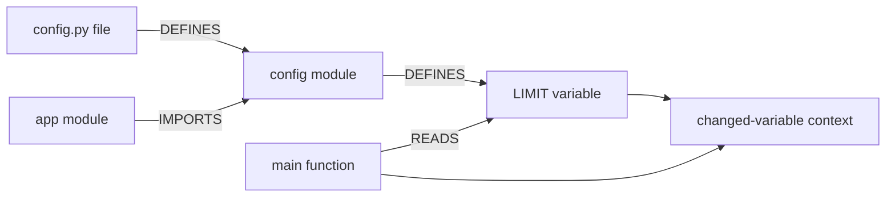

# How Sentinel turns code into useful review context

The graph is a structural index, not a program interpreter. It records declarations and
observable relationships so the reviewer can ask what surrounds a change. It never proves
that arbitrary runtime behavior is safe.

## Follow a changed constant

Suppose `config.py` defines `LIMIT = 10`, and `app.py` imports it as `maximum` inside
`main()`. Changing `LIMIT` should include `main()` even when `app.py` did not change:



1. [`PythonAnalyzer.analyze`](../src/sentinel/analysis/ast/python_analyzer.py) records the
   assignment as a `Symbol`. Annotated declarations such as `LIMIT: int = 10` count too.
2. [`global_accesses`](../src/sentinel/analysis/ast/python_access.py) uses Python's symbol
   table to distinguish a global reference from a parameter or local variable with the
   same spelling. It records access sites, not values or source text.
3. TypeScript and JavaScript use the compiler parser in
   [`ts_extract.js`](../src/sentinel/analysis/ast/ts_extract.js). Its
   [`ts_bindings.js`](../src/sentinel/analysis/ast/ts_bindings.js) helper asks the compiler
   which declaration an identifier belongs to. Its virtual compiler host exposes only
   the source already supplied; it reads no project config, plugins, libraries or files.
4. [`FileSymbols`](../src/sentinel/core/domain/code.py) is the shared language-neutral
   result: declarations, imports, calls, routes, database operations and variable accesses.
5. [`GraphBuilder`](../src/sentinel/analysis/graph/builder.py) creates file, module and
   variable nodes as well as functions/classes/tests. `DEFINES` records their ownership.
   Nested functions belong to their enclosing function. Imports connect known modules.
6. [`add_variable_edges`](../src/sentinel/analysis/graph/variables.py) resolves local globals,
   named-import aliases and namespace imports to known variables. Unknown packages and
   ambiguous/dynamic relationships are omitted. An increment records both READS and WRITES.
7. [`ContextEngine`](../src/sentinel/analysis/graph/context.py) identifies the changed variable
   by its source span and includes its definition and bounded consumers. For a changed
   function, it can include the global definitions that function uses. Existing character
   budgets and secret redaction still apply.
8. [`architecture_subgraph`](../src/sentinel/analysis/graph/architecture.py) selects a bounded
   deterministic projection for the UI. Files/modules stay in the full graph but are hidden
   from the visual flow. Variable labels do not acquire function parentheses.

## Identity and ownership matter

Two files can both declare `GET /health`. Their endpoint IDs include the file and handler;
they cannot accidentally share one node and manufacture a path between unrelated handlers.
Variable nodes are also scoped by file, not just by their spelling.

A UI projection owns copies of its nodes. Setting `meta["changed"]` on a projected node must
not alter the analysis graph. Otherwise a previous view could change the evidence used by
another query. `CodeGraph.subgraph` therefore copies node metadata as well as the node.
Stable sorting breaks budget ties so repeated projections produce the same output.

The symbol-cache version is part of its key. Version 4 invalidates results produced before
variable access extraction existed; unchanged file bytes alone do not mean an old analyzer
result is compatible with a new analyzer implementation.

## What the edges establish

`main --READS--> LIMIT` means a recorded lexical reference resolved to that module variable.
It does **not** prove which value `LIMIT` holds, that `main` executes, or that user-controlled
input reaches a sensitive operation. READS/WRITES edges also connect code to known database
tables; the target node kind tells those relationships apart.

Supported variable analysis is deliberately bounded: ordinary module declarations and
global/imported references. Class fields, arbitrary local-variable graphs, destructuring,
Python lambda/comprehension inner scopes, dynamic imports, package re-exports and arbitrary
property/value propagation are not complete. Python records the outer comprehension iterable
but does not guess the inner scope. TypeScript regex fallback has no binding analysis and is
reported as degraded parsing. These limits do not become proof that a missing edge is safe.

## Learn it by changing it

Run:

```bash
pytest tests/unit/test_graph_dependencies.py tests/unit/test_context_engine.py -v
```

Read the changed-constant test first. Then read the parameter/local shadowing tests: the
same identifier spelling must not invent a dependency. Follow with the endpoint identity,
subgraph independence, serialization and hard-budget tests. Finally compare graph JSON for
a real demo review with the architecture view. This is a useful distinction to explain in
an interview: parsing, binding, graph construction and context selection solve different
problems and live in different modules.
