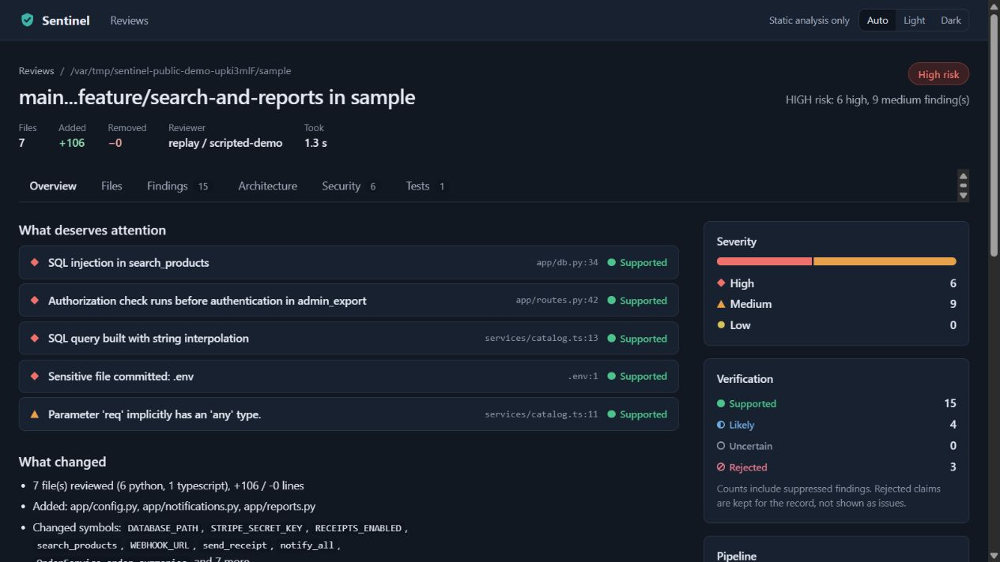
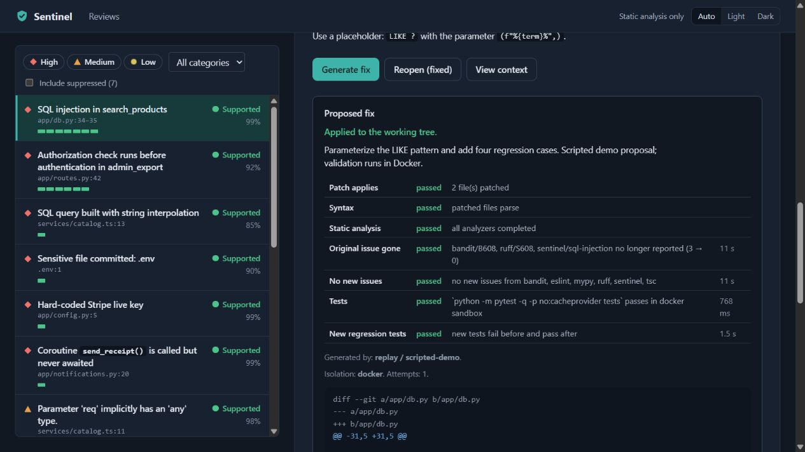

# Try Sentinel with sample code

This is the public, repeatable demonstration in the
[Sentinel GitHub repository](https://github.com/krish-121/Ai-code-reviewer).
You do not need a GitHub account, AI key, subscription or local model to run it.
All sample code is invented. Your own private repository is not needed.

**The AI replies in this demo are scripted.** The UI identifies the reviewer and
fix generator as `replay / scripted-demo`. Source analysis, the code graph,
verification, database, Docker checks and Apply run normally. This demonstrates
the engineering workflow without depending on a free model's availability or quota.
For separate real-model evidence, read [the Gemini/DeepSeek browser test](BROWSER_LIVE_WORKFLOW.md).

## 1. Check the tools

Use a Linux terminal. On Windows, open Ubuntu in **WSL 2** and enable Ubuntu in
Docker Desktop's WSL integration settings. Keep Docker Desktop running with Linux
containers. The commands below target Linux or Ubuntu in WSL. Native Windows
PowerShell is not a supported fix path; this complete demo has not been rehearsed
on macOS.

You need Git, Python 3.11 or newer, Node.js 22.13 or newer, npm and Docker:

```bash
git --version
python3 --version
node --version
npm --version
docker info
```

Git creates the sample's before/after history. Python runs Sentinel. Node runs the
JavaScript/TypeScript analyzers. Docker provides disposable containers in which
Sentinel tests proposed changes. A container is an isolated process environment;
here it contains language runtimes and analysis tools, not an AI model.

If a tool is missing, use its official instructions:
[Docker Desktop on Windows](https://docs.docker.com/desktop/setup/install/windows-install/),
[Node downloads](https://nodejs.org/en/download), and
[Python virtual environments](https://docs.python.org/3/library/venv.html).


## 2. Download the public project

Choose a new folder name; Git refuses to clone into an existing nonempty folder.

```bash
git clone https://github.com/krish-121/Ai-code-reviewer.git sentinel
cd sentinel
```

This copies public source code to your computer. It does not connect a GitHub App,
publish your files, change a repository's visibility or need a GitHub token.
The sample templates are in [demo/sentinel-demo-repo](../demo/sentinel-demo-repo).
One checkout contains both Sentinel and the examples; a second hosted repository
is not needed to try them.

## 3. Install Sentinel in its own Python environment

```bash
python3 -m venv .venv
source .venv/bin/activate
python -m pip install -c requirements.lock -e ".[dev,analyzers]"
```

The `.venv` folder keeps this project's Python packages separate from other
projects. `requirements.lock` selects the versions used by CI. `-e` links the
installed command to this checkout, so you can study and edit the source.
Keep the environment activated for the later commands. This installation needs
internet access to download packages; it does not contact an AI provider.

## 4. Install the JavaScript/TypeScript analysis tools

```bash
npm ci --prefix tools/analyzers --omit=dev --no-audit --no-fund
export PATH="$PWD/tools/analyzers/node_modules/.bin:$PATH"
export NODE_PATH="$PWD/tools/analyzers/node_modules"
```

`npm ci` uses the checked-in lockfile. `PATH` lets Sentinel find the tools;
`NODE_PATH` lets Node find their libraries. Run these exports again if you open
a new terminal. The web interface is already built and included in the checkout;
you do not need to install or build `web/` just to try this demo.

## 5. Build the test container image

```bash
docker build -f Dockerfile.sandbox -t sentinel-sandbox:latest .
```

An image is the prepared filesystem used to start a container. This image contains
Python, Node, pytest and Sentinel's analysis tools. The first build downloads files
and uses disk space; it does not download Ollama or an AI model. Later builds reuse
unchanged layers.

During fix validation, containers have no network, a read-only system filesystem,
limited resources, and only a disposable copy of the sample to work on. They receive
neither your API keys nor your home folder. The trusted host script uses Docker;
the generated code receives no Docker socket. The demo defaults to copy transport,
which also works when Docker Desktop cannot directly mount a WSL temporary path.

## 6. Create and review the sample

```bash
python scripts/seed_demo.py
```

The script creates `.demo/sentinel-demo` with two local Git branches: `main` is the
before version; `feature/search-and-reports` adds the planted problems. It reviews
that change, stores the result in `.demo/sentinel-demo.db`, and prepares one SQL fix.
The fix restores parameter binding and adds four test cases. Sentinel runs all seven
normal validation checks, including proving the new tests fail before the fix and
pass afterward. **It does not apply the fix.**

The terminal should report `completed` for the review and `validated` with `docker`
isolation for the scripted fix. `.demo/sentinel-demo.receipt.json` contains actual
results. Full-demo success requires the four finding categories, a rejected claim
and successful validation; an incomplete result exits with an error. IDs and
finding counts may differ across runs.

The script constructs fresh demo settings instead of loading your saved settings
or environment API keys. Database/cache files stay under ignored `.demo/`. It refuses
to replace existing files, including a previous sample or database.

If Docker is unavailable, `python scripts/seed_demo.py --review-only` prepares just
the scripted review. That option does **not** claim the fix-validation demo passed.
Use new paths when later preparing the complete version.

## 7. Open the browser and follow the evidence

```bash
python scripts/serve_demo.py
```

Open **http://127.0.0.1:8820**. Keep that terminal open. The server uses only the
selected demo database and sample folder, runs the normal job worker, and listens
on your own computer. It does not start a public tunnel. It checks the matching
demo receipt before opening the database. The header's “Static analysis only”
describes the absence of a configured external provider; each saved example review
and proposal explicitly identifies the injected **scripted replay**.

Use this short tour:

1. Open the sample review. **Overview** shows what changed, supported findings,
   remaining uncertainty and pipeline stages. Confirm `replay / scripted-demo`.
2. Open **SQL injection in search_products** at `app/db.py:34`. Follow
   `GET /search → search() → search_products()` and read the independent analyzer
   and SQL-probe evidence. User input was inserted into a SQL string.
3. Return to **Findings** and select **Include suppressed**. Open **SQL injection
   in find_user**. It is rejected because that query already uses a placeholder and
   separate parameters. The demo also rejects invented helper names and a style remark.
4. Use **Overview**, **Tests**, **Security** and **Architecture** to inspect missing
   test coverage, unsafe async calls, authorization order, and inferred call paths.
   N+1 and quadratic-loop warnings remain labelled likely rather than exploit proofs.
5. Return to the `search_products` SQL finding and scroll to **Proposed fix**.
   The prepared proposal should show seven passed checks and the scripted model.
   You may click **Generate fix** before applying to exercise the normal queue again;
   only this supplied SQL fix is scripted, not arbitrary fixes for every finding.
6. Click **Apply to working tree** if you want to write the validated proposal into
   this disposable sample. The finding becomes fixed. Only `app/db.py` and the new
   `tests/test_db_regression.py` are written. Nothing is pushed or committed.

The two existing tests plus four new cases pass after Apply. The cases cover normal
search, missing input, SQL injection text and an apostrophe-containing name.
The original review retains its original source snapshot and risk: it records the
change that was reviewed. Apply changes the working tree, not branch history or
Git's staging area. Re-reviewing the same committed range still reviews that old change.





## 8. Stop, reopen or start a fresh sample

Press **Ctrl+C** in the demo server terminal to stop it. Run `serve_demo.py` again to
reopen saved results. This does not stop another Sentinel server or the owner's
OpenCode bridge. Rerunning `seed_demo.py` on existing paths deliberately fails.

For a clean second run, choose new paths:

```bash
python scripts/seed_demo.py --repo .demo/second-sample --db .demo/second.db
python scripts/serve_demo.py --repo .demo/second-sample --db .demo/second.db
```

If port 8820 is occupied, append `--port 8821` to the server command and open that
address. If Python cannot find `sentinel`, reactivate `.venv` from step 3. If JS
analyzers are missing, repeat step 4 in the checkout root. If validation is incomplete,
read the receipt and check Docker/image availability; no unverified fix can Apply.

## What is public and what stays local

The public templates deliberately include an invented `.env` and an obviously
synthetic Stripe-shaped key to test secret detection. They are fixtures, not usable
credentials. The reviewed `.env` body is excluded from model context. Do not put real
credentials in either fixture. These specific fixture files are intentional exceptions
in `.gitignore`; your ordinary `.env`, private keys and local databases remain ignored.

Do not upload `.demo/`, `.venv/`, `node_modules/`, private user configuration or keys.
The demo uploads none of them. No saved Gemini settings change, no model is installed,
and no GitHub App, Smee relay or webhook connection is needed.

## Learn from the implementation or try a live model

Read [the walkthrough](WALKTHROUGH.md#how-the-public-demo-stays-repeatable),
[the demo builder](../demo/build_demo_repo.py),
[the shared demo wiring](../scripts/demo_support.py),
[the seed script](../scripts/seed_demo.py),
[the local server](../scripts/serve_demo.py), and
[the checked-in replay](../scripts/demo_ai_responses.json).
The replay is a dependency supplied by demo tooling; it is not a new production
AI provider and does not bypass normal validation.

To assess real AI output, follow [free Gemini/DeepSeek setup](FREE_AI_FALLBACK.md)
with your own credentials and run the normal Sentinel CLI in a fresh generated
sample. Do not use replay output to claim model accuracy. The separate
[live browser report](BROWSER_LIVE_WORKFLOW.md) identifies exactly which model calls
were real. Distributed live-provider acceptance, complete outage/accessibility/load
checks and always-on hosting remain separate operational work.

## Verification checkpoint

The 19 October 2026 rehearsal completed all seven normal checks, explicit browser Apply and six tests on the actual applied sample in Docker. Four demo regressions pass, including settings isolation and existing/unrelated-data protection. See [PROGRESS.md](../PROGRESS.md) for the full local suite and [GitHub Actions](https://github.com/krish-121/Ai-code-reviewer/actions) for hosted checks on each published revision. These results describe the scripted sample workflow, not model accuracy.
