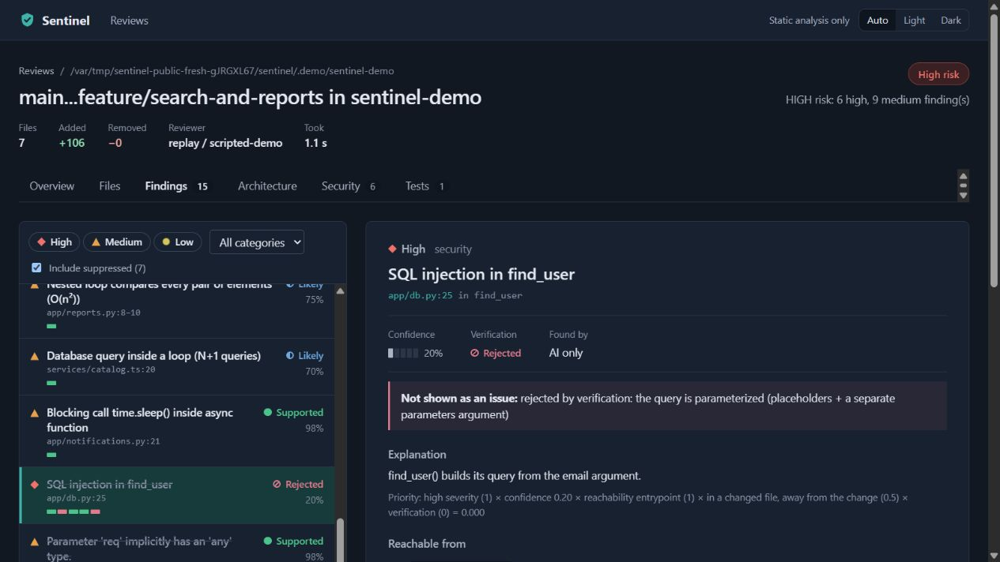

# Public demo: fresh-download verification

Confirmed **20 October 2026** on the public demo implementation
[`a435e0c`](https://github.com/krish-121/Ai-code-reviewer/commit/a435e0cf0ca10886f9681f012bc28e09ffdeece0).
This is a visitor rehearsal of [PUBLIC_DEMO.md](PUBLIC_DEMO.md), using the public
GitHub download and its own new Python environment. The implementation needed no
code repair during this follow-up. Documentation and screenshots record the result.

## 1. Download and install

We cloned the public repository into a new folder, created a new virtual environment
with Python **3.14.4**, installed the locked Python/Node analysis dependencies and
built the documented sandbox image. Imports were checked to come from this fresh
checkout. The application checkout stayed clean in Git; `.demo/`, dependencies and
database files were ignored. This catches dependencies that could otherwise be
accidentally supplied by the development environment.

## 2. Prepare the sample

The public `seed_demo.py` command completed normally. Review **`R-d40693ae77`**
contained bug, security, performance and test-gap findings, plus three rejected claims.
Its prepared fix **`X-bd7079001f`** passed all seven normal checks in Docker. The
source still exactly matched the buggy sample, and the proposed new test did not
exist in the working tree: preparation and validation had not applied anything.

The provider is **`replay / scripted-demo`**. Its replies are deliberately supplied
by the demo; analysis, graph/context, verification, storage, queue, Docker validation
and Apply use the normal implementations. This run made no live model requests and
does not measure AI accuracy. Separate real-model evidence is in
[BROWSER_LIVE_WORKFLOW.md](BROWSER_LIVE_WORKFLOW.md).

## 3. Restart and inspect the rejected warning

After the earlier interruption, the local demo server was restarted from that same
download, environment and database. Its completed review and validated proposal were
still available. In the browser, **Include suppressed** exposed **SQL injection in
find_user**. The detail view explained that the query already uses placeholders and
separate parameters, so the claim is rejected. This demonstrates why the viewer
should inspect evidence rather than trust every suggested warning.

Docker Desktop had stopped during the interruption. We started the existing official
installation and checked that its engine and the trusted `sentinel-sandbox:latest`
image were available before generating another proposal. Nothing needed reinstalling;
no sample/generated tests were moved onto the host.

## 4. Generate a new proposal through the browser

On the supported **SQL injection in search_products** finding **`F-a79826c818`**,
we clicked **Generate fix**. The normal queue/worker produced **`X-43d96eb088`**,
distinct from the proposal prepared by the seed script. All seven checks passed:

1. Patch applies to the permitted files.
2. Patched Python syntax parses.
3. Required static analyzers finish in Docker.
4. The original SQL diagnostics disappear, **3 → 0**.
5. No new blocking diagnostics appear.
6. The project tests pass in Docker.
7. The new regression cases fail on the buggy code and pass on the patched code.

## 5. Apply and test the actual files

We clicked **Apply to working tree** in the browser. Only **`app/db.py`** and
**`tests/test_db_regression.py`** were written in the disposable sample. The fix became
applied, the finding became fixed, and that state survived browser reload. The API
no longer offered the applied attempt for another Apply.

A separate Docker run tested the actual written files: **six tests passed**. They
include the two existing tests and four new cases for ordinary input, missing input,
SQL-injection input and an apostrophe-containing name. A request to review the
containing Sentinel application directory was refused with **403**: the demo server
was authorized only for its sample root.

Apply updates the working tree. The saved review continues to show the original
reviewed code and risk, and the sample's committed feature branch still contains the
planted bug. Use fresh paths for another clean run; the scripts preserve existing work.

## 6. GitHub checks

All three jobs for the implementation revision passed in
[run 39299740562](https://github.com/krish-121/Ai-code-reviewer/actions/runs/39299740562).
The completed logs confirm **678 Python tests passed, one test skipped**,
**27 frontend tests passed**, strict typing/format/coverage checks passed, and the
full isolated Docker/Compose acceptance passed. PostgreSQL variants ran in GitHub;
the earlier local result was **652 passed with 27 PostgreSQL variants skipped**.

These are checks on the named code revision. Later documentation-only publications
have their own runs. No check was disabled or weakened, and no private repository
was made public. The demo requires no AI key, subscription or local model download.

## What this closes

The public sample can be downloaded, prepared, reopened and exercised through a new
browser-generated proposal, real validation and explicit Apply. Start Docker before
generation after a computer restart. The normal app's saved Gemini choice and keys
are separate from this demo. Smee was not reconnected.

Broader model quality, complete outage/accessibility/load checks and distributed
live-provider acceptance remain separately listed in [RELEASE_READINESS.md](RELEASE_READINESS.md).
